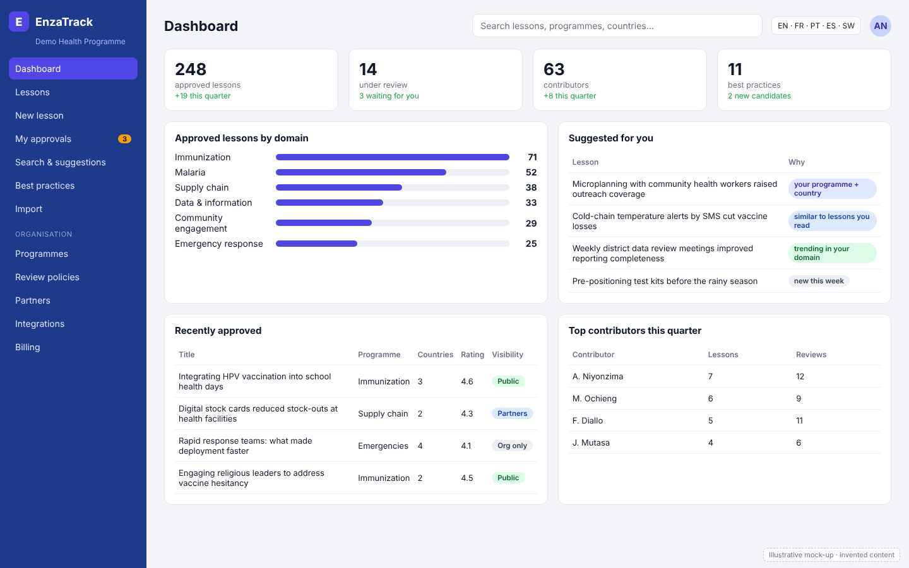
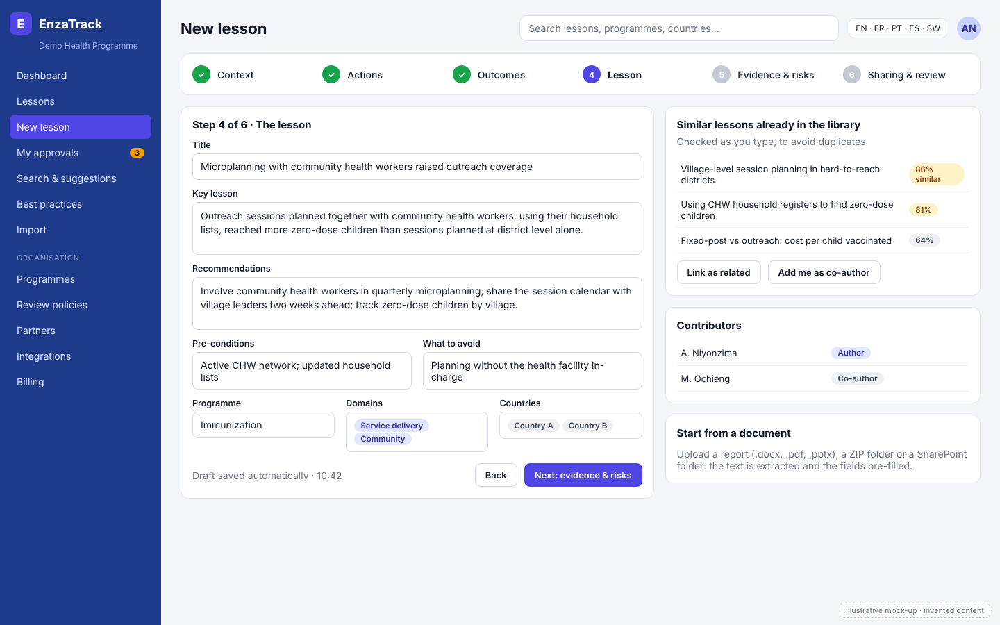
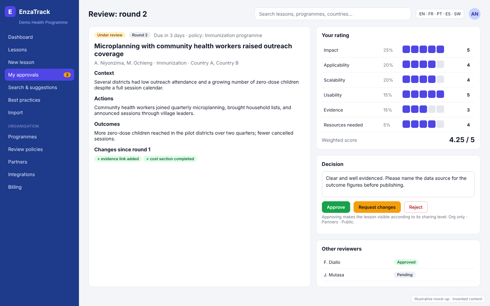
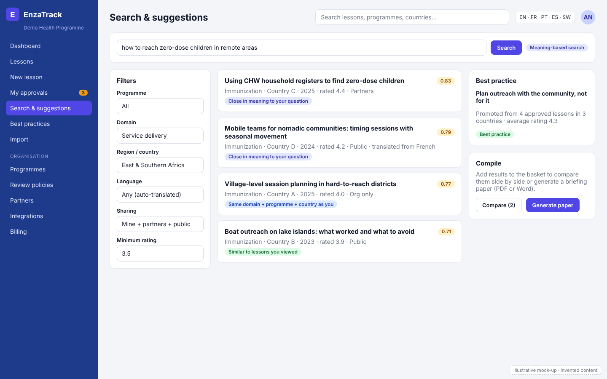
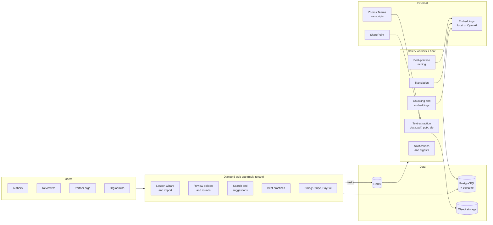
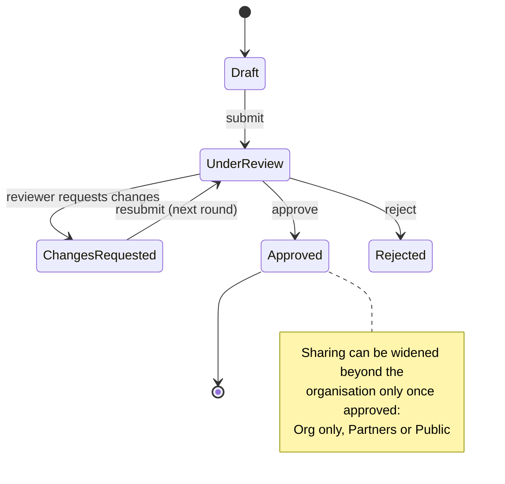

# EnzaTrack: lessons-learned platform for public health programmes

**EnzaTrack helps organisations capture what their programmes learn, review it, and put it in front of the people who need it next, across countries, languages and partner organisations.**

This is a case study. The product's source code is private; this page explains what it does and how it is built. It includes three short excerpts from the code.

> The screens below are **illustrative mock-ups** built from the application's real layout, fields and workflow, filled with invented content. They are not screenshots of a live deployment.

| | |
| --- | --- |
| **Type** | Multi-organisation SaaS (web app, installable as a PWA) |
| **Size** | ~35,000 lines of Python, 94 data models, 211 templates, 255 routes, 19 background-task modules |
| **Stack** | Django 5, PostgreSQL + pgvector, Celery + Redis, Channels, Tailwind, Docker |
| **Languages** | English, French, Portuguese, Spanish, Kiswahili (interface and content translation) |
| **Author** | Steve KUBENGA BANZA: product design, architecture and development |

---

## The problem

Public Health Programmes learn a great deal, but most of it stays in mission reports, meeting minutes and people's heads. When a new team faces the same problem in another country two years later, the lesson is hard to find, not trusted, or written in another language. Lessons that are found are rarely compared, and good practices are seldom distilled from them.

EnzaTrack turns that knowledge into structured, reviewed, searchable lessons, and keeps track of who may see what.

---

## A tour

### 1. Dashboard
The organisation's dashboard shows:
- approved lessons by domain;
- lessons waiting for review;
- top contributors;
- **suggestions for each user**, each with the reason it was suggested.

### 2. Writing a lesson
A six-step wizard guides the author: **context → actions → outcomes → the lesson → evidence & risks → sharing & review**. It also covers recommendations, pre-conditions, what to avoid, resources needed, evidence links, risk tags, programme, domains and countries.

While the author types, **similar lessons already in the library** appear, so duplicates are linked or merged rather than written twice. Co-authors can be added. A lesson can also **start from a document**: a `.docx`, `.pdf` or `.pptx`, a ZIP of reports, a SharePoint folder, or a Zoom or Teams meeting transcript. The text is extracted and the fields are pre-filled.

### 3. Review and approval
Each programme can have its own **review policy**: who reviews, which groups are auto-assigned, and deadlines. Reviewers can:
- **approve**, **request changes** (which starts a new review round) or **reject**;
- rate the lesson on a **weighted rubric**: impact 25%, applicability 20%, scalability 20%, usability 15%, evidence 15%, resources 5%.

Only approved lessons can be shared beyond the organisation.

### 4. Search, suggestions and best practices
Search works on **meaning, not just keywords**: lessons are split into chunks and embedded as vectors in PostgreSQL (pgvector). Results respect sharing rules and can be filtered by programme, domain, region, language, sharing level and rating.

Lessons in other languages are found and shown **translated**. Selected lessons can be **compared** side by side or **compiled into a briefing paper** (PDF or Word).

**Best practices** are mined automatically. Clusters of well-rated, shareable lessons that say similar things are synthesised into a single practice by a language model. The practice keeps links to its evidence, plus metrics: average rating, evidence strength, number of supporting lessons and adoption.

---

## How it is built

### Lesson life cycle

---

## Design decisions worth discussing

**1. Who can see a lesson is decided in one place, in the database query.**
- **Org only:** visible to the organisation's own staff.
- **Partners:** also visible to organisations the host has explicitly linked as partners.
- **Public:** visible to everyone, including anonymous visitors.

A single queryset method, `visible_to(user)`, applies these rules with one SQL query (a subquery for partner links, no Python lists). Every list, search and suggestion uses it, so no screen can leak a lesson by forgetting a check. → [`code-samples/lesson_visibility.py`](code-samples/lesson_visibility.py)

**2. Embeddings follow the subscription, and plan limits can't be bypassed.**
- **Local model by default:** organisations embed with a local SentenceTransformers model, free and unmetered.
- **OpenAI on plans that include it:** these use OpenAI embeddings, metered against a monthly allowance.
- **Limits hold:** if the allowance is exhausted, the call fails on purpose, instead of silently falling back to the local model. A fallback is allowed only for technical errors, and only when switched on.

→ [`code-samples/embeddings_router.py`](code-samples/embeddings_router.py)

**3. Best practices are evidence-backed, not just generated.**
- **Only strong lessons qualify:** approved, shareable, rated 3.5 or more, with an evidence strength of at least 2.
- **Clusters come from similarity:** lessons linked at similarity 0.78 or above form connected groups, and a group needs at least 3 lessons.
- **The language model writes from evidence:** it receives only the cluster's lessons and returns strict JSON. That covers the title, steps, pre-conditions, risks and metrics.
- **Traceability is kept:** each practice links back to its evidence, with computed rating, evidence and adoption metrics.

→ [`code-samples/best_practice_mining.py`](code-samples/best_practice_mining.py)

**4. Other choices:**
- **Heavy work is asynchronous**, with progress shown to the user: extraction, embeddings, translation, SharePoint ingest, transcript capture and digests.
- **Secrets stored for integrations are encrypted** (Fernet), with a management command to rotate keys.
- **Sign-up is protected** against abuse (Turnstile, rate limiting); per-organisation SSO settings are available.
- **Everything is translatable:** the interface and the reference data (countries, rating dimensions, risk tags) come in five languages.
- **It installs as an app (PWA)**, with an offline banner and page for unreliable connections.

---

## Features at a glance

| Area | What it does |
| --- | --- |
| Capture | 6-step wizard, autosave, co-authors, contributor roles, duplicate detection while typing |
| Import | Single files, ZIP folders, SharePoint folders; Zoom and Teams transcripts; text extraction and pre-filling |
| Review | Policies per programme, reviewer groups, rounds, deadlines, approve / request changes / reject, weighted rubric |
| Sharing | Org only, partners, public; partner organisations; per-organisation branding |
| Find | Semantic search (pgvector), filters, translations, bookmarks, compare, briefing papers (PDF, Word) |
| Learn | Personal suggestions with reasons, best practices mined from evidence, domain subscriptions and digests |
| Run | Multi-organisation onboarding and invitations, roles, analytics, notifications, Stripe and PayPal subscriptions with plan limits |

---

## About this repository

- **`docs/`**: the mock-up images used above.
- **`mockups/`**: the HTML used to make them (`python mockups/build.py`).
- **`code-samples/`**: three excerpts from the private source, shown for reading. They depend on the application's models and don't run on their own.

The full source and a live walkthrough are available on request.

Steve KUBENGA BANZA, PMP · Data Management and Analytics · [LinkedIn](https://www.linkedin.com/in/stevekubengabanza/)

© Steve KUBENGA BANZA. All rights reserved. No licence is granted to use, copy or modify the code excerpts.
